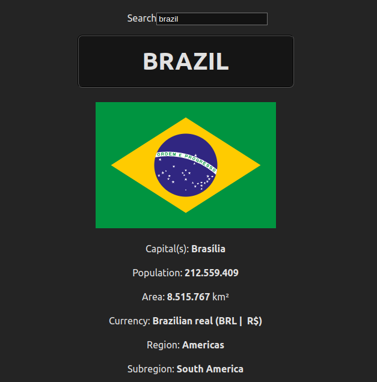

# Countries List

## Table of Contents
- [About](#about)
- [Usage](#usage)


## About

Single Page Application to search for a specific country information, such as: flag, capital(s), population, area (in km²), currency, region (continent), subregion, borders and official languages.




## Usage

Install dependencies
```bash
npm install
```

Run the app
```bash
npm run dev
```
